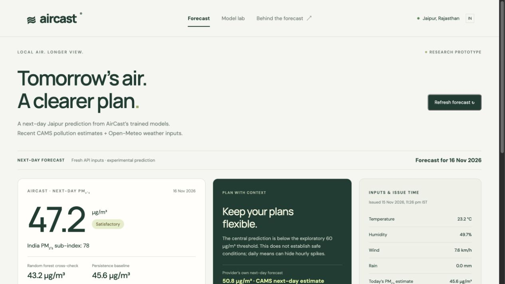

# AirCast: Jaipur air, a day ahead
**Team:** Nitaksh Jain and Kyros Goyal, Neerja Modi School. Equal contributions (50% each), confirmed by the team.

[Live prototype](https://aircast-climate-lab.kyros-g2028.chatgpt.site/) · [Open in Colab](https://colab.research.google.com/github/fr3ddykru3g3r/aircast-jaipur/blob/main/AirCast.ipynb) · [Project write-up](submission/project_writeup.md)

AirCast runs frozen machine-learning models on recent Jaipur pollution/weather estimates to predict the next India-calendar day's mean PM2.5. Model lab separately documents an honest 2025 evaluation. This is an experimental research prototype.



## Features and stack
- Current next-day inference, source/issue time and downloadable forecast/input records.
- Ridge, random forest, persistence and a separate provider forecast comparison.
- Historical replay, scenario inputs, warning trade-offs and a chronological evaluation.
- Static HTML/CSS/JavaScript; Python, pandas, NumPy, scikit-learn and Matplotlib for research.

## Run the dashboard
```sh
python3 -m http.server 8000 --directory dist
```
Open http://localhost:8000. Do not open index.html directly via file://. Training needs no API key. Current forecasts call the public Open-Meteo APIs in the browser. If live requests fail, a same-day snapshot no older than two hours may be shown with an explicit label; otherwise the current forecast is unavailable. Historical analysis remains bundled.

## Reproduce and test
```sh
python3 -m venv .venv
source .venv/bin/activate
pip install -r requirements.txt
python train.py
python verify.py
python -m unittest discover -s tests -p 'test_*.py'
node tests/frontend.test.cjs
node tests/live.test.cjs
```
Node 18+ is needed only for frontend tests. requirements-lock.txt records the tested Python 3.14 environment; requirements.txt allows compatible Colab versions. The notebook contains saved results and a chart. Its first cell clones this public repository if the project files are missing. Cloud Colab execution itself has not been verified end to end.

## Historical data and evaluation
26,304 hourly API timestamps from 2023–2025; 1,089 usable next-day examples. Downloaded and trained on 15 November 2026 during the hackathon. Dates describe observations, not development duration. Daily aggregates need 18 valid hours. Features are trailing pollution history, origin-day weather and known seasonal calendar values. Training-only scaling and chronological target-date splits prevent conventional future-target leakage.

Train: 8 January 2023–30 June 2024 (540); validation: July–December 2024 (184); test: all 365 days of 2025. Validation MAE selected ridge; test data did not select or train models.

| Model | MAE µg/m³ | RMSE µg/m³ | R² |
|---|---:|---:|---:|
| Persistence | 7.391 | 10.335 | 0.569 |
| Ridge | 7.085 | 9.661 | 0.624 |
| Random forest | 7.235 | 9.927 | 0.603 |

Ridge reduces historical MAE by 4.1%, without a significance claim. At >60 µg/m³: TP=15, FN=15, FP=7, TN=328; precision 68.2%, recall 50.0%. Empirical interval radius 10.47 µg/m³ covers 291/365 test outcomes (79.7%); validation also selects the model, so no guaranteed coverage is claimed. On 13 June 2025 the model predicts 25.45 versus archived 66.79.

## Limits
CAMS references are gridded model estimates, not CPCB measurements or street-level exposure. Weather reanalysis is retrospective. The live pipeline uses today's full-day provider estimates, including remaining forecast hours, and a weather product different from historical reanalysis. Historical accuracy is not live accuracy; no calibrated live interval is shown. Tomorrow pollution is excluded from model inputs and appears only as a provider comparison. Daily averages miss hourly spikes; scenarios are not causal interventions. No user study, health benefit or real-world safety validation is claimed. Next steps: Jaipur sensor validation and prospective issue-time evaluation.

## Submission materials
See [submission/](submission/) for the write-up, demo script, seven-slide outline/deck, technical Q&A, credits and audit. See screenshots/ for actual prototype captures. A captioned demo video is a screenshot-based walkthrough, not a continuous screen recording or student voice-over. Submission completion must be supported by the saved form confirmation, not inferred from these files.

## Credits
Data: [Open-Meteo/CAMS air quality](https://open-meteo.com/en/docs/air-quality-api), [Open-Meteo historical weather](https://open-meteo.com/en/docs/historical-weather-api), and [Open-Meteo Forecast API](https://open-meteo.com/en/docs). Open-Meteo: CC BY 4.0; contains modified Copernicus Atmosphere Monitoring Service information. [CPCB AQI methodology](https://airquality.cpcb.gov.in/ccr_docs/About_AQI.pdf) supplies PM2.5 sub-index bands, not our pollution observations.

Software: [Python](https://python.org), [NumPy](https://numpy.org), [pandas](https://pandas.pydata.org), [scikit-learn](https://scikit-learn.org), [Matplotlib](https://matplotlib.org); HTML/CSS/JavaScript; [Google Fonts](https://fonts.google.com) DM Sans and Manrope. Submission artifacts: python-pptx, ReportLab, Pillow and FFmpeg. No pretrained prediction model was reused. [OpenAI Codex](https://openai.com/codex/) assisted with implementation, testing, analysis code, interface, documentation and submission preparation. Students must understand and explain the work.
